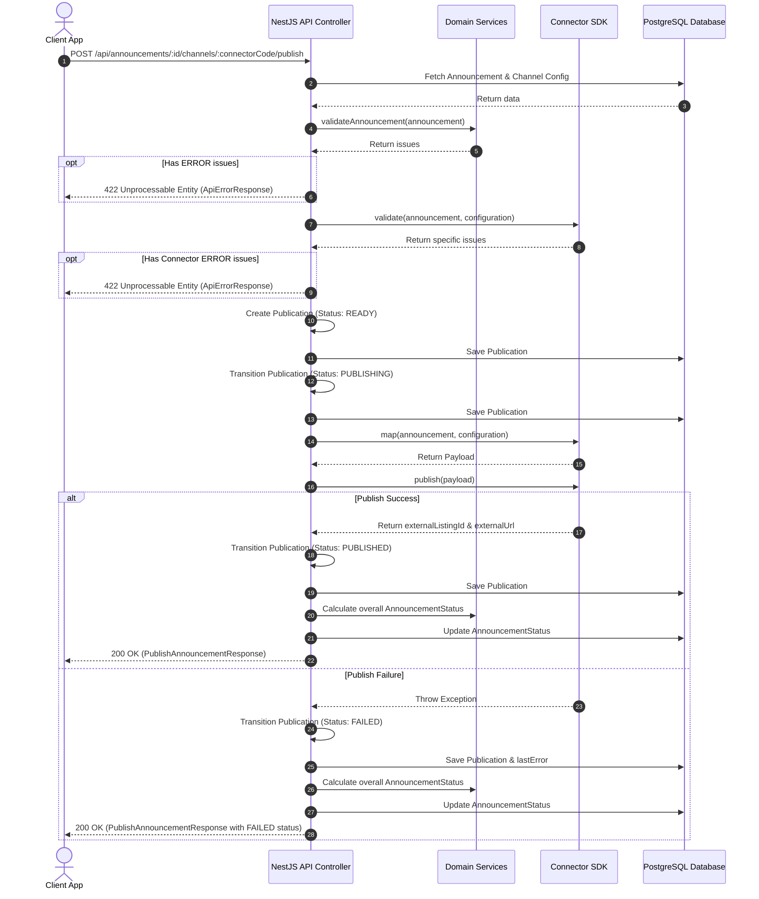

# Announcement Publication Flow

This document details the publication flow from the creation of an announcement to its final states on the marketplace channels.

---

## 1. Sequence & Architecture Diagram

---

## 2. Detailed Steps

### Step 1: Selection & Configuration
Before publishing, a channel must be enabled for the announcement:
- Client issues `PUT /api/announcements/:id/channels/:connectorCode`.
- This enables the channel and persists the marketplace-specific JSON `configuration` in the database.

### Step 2: Pre-Publication Validation
When publication is triggered (`POST /api/announcements/:id/channels/:connectorCode/publish`), the orchestrator performs two checks:
1. **General Validation**: Uses `validateAnnouncement` from `@marketplace-hub/domain`.
2. **Connector-Specific Validation**: Invokes the `validate` method of the target connector interface.
If either check contains any validation issues with severity `ERROR`, the publication is blocked, and the transaction fails immediately.

### Step 3: State Transitions
The publication attempt transitions as follows:
- **`READY`**: Created in the database, representing a valid attempt ready for transmission.
- **`PUBLISHING`**: The orchestrator transforms/maps the announcement to the target payload using the connector's `map` method, then calls `publish(payload)`.
- **`PUBLISHED` / `FAILED`**: Based on the network/API result of the connector call, the publication is updated.
  - On Success: Saves the `externalListingId`, `externalUrl`, and `publishedAt` timestamp.
  - On Failure: Saves the `lastError` string.

### Step 4: Overall Announcement Status Update
Every time a publication completes (successfully or not), the overall status of the `Announcement` is updated:
- If all enabled channels are in `PUBLISHED` state, the status is set to `PUBLISHED`.
- If some enabled channels are `PUBLISHED` and others are `FAILED` or `READY`, the status is set to `PARTIALLY_PUBLISHED`.
- Otherwise, it remains `READY` or `DRAFT`.
